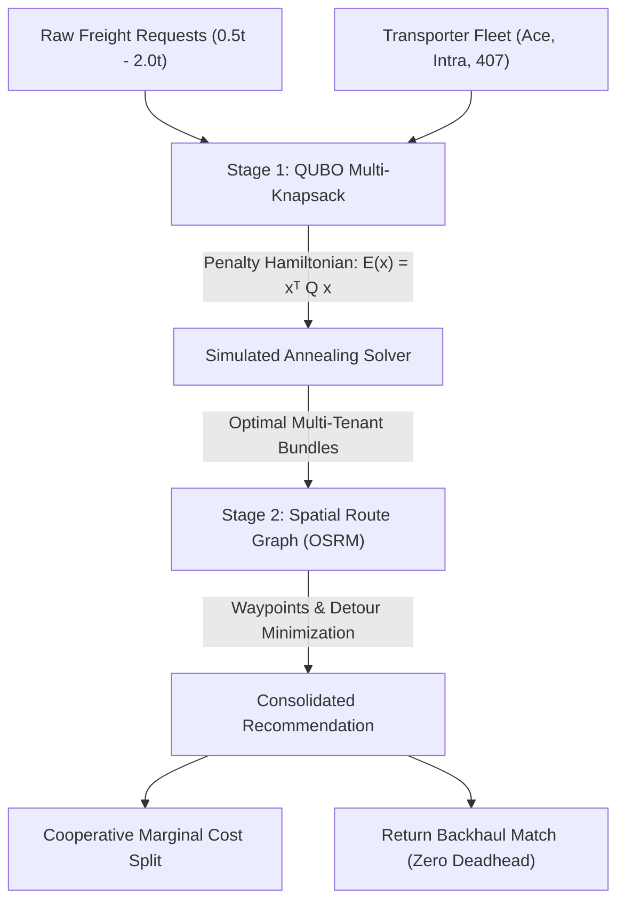

# FREIGHTGRID · Rural Freight Intelligence & Optimization Network
> **Tech4Bharat · Quantum-Inspired Multi-Tenant Logistics Coordination**  
> *Turning fragmented rural freight into coordinated supply.*

---

## 🌾 The Problem Statement
In rural India, over **35–45% of truck trips return empty (deadheading)**, and smallholder farmers with 0.5–2 tonnes of harvest pay up to a **40% LTL (Less-Than-Truckload) surcharge** because no local coordination mechanism exists. 

Consumer *"Uber for Trucks"* apps fail in rural markets due to digital literacy barriers, volatile cellular connectivity, and deep distrust of automated algorithmic dispatch. 

**FREIGHTGRID** is an **operator-driven Logistics Command Center** designed for APMC Mandis, Farmer Producer Organizations (FPOs), and rural transport cooperatives.

---

## ⚡ The 2-Stage Optimization Architecture



### Stage 1: QUBO Combinatorial Grouping
Formulates the vehicle assignment and load clustering as an energy minimization problem:
$$\min E(x) = x^T Q x$$
Where $x_{ij} \in \{0, 1\}$ encodes request $i$ assigned to vehicle $j$. Penalties enforce vehicle capacity, time windows, and perishable goods compatibility. Solved in $<1.5$ seconds using **Simulated Annealing on classical hardware**.

### Stage 2: Spatial Graph Routing
Sequences farm gate pickups and deliveries using real Indian road topology via **Open Source Routing Machine (OSRM)** to eliminate redundant detours.

---

## 🛣️ Pilot Corridor Case Study (NH-75)
* **Corridor:** Srinivaspur $\rightarrow$ Mulbagal Cross $\rightarrow$ Hoskote $\rightarrow$ KR Market (Bengaluru)
* **Vehicle:** Tata 407 LPT (5.0 Tonne Rated)
* **Consolidated Cargo:** 3.8 Tonnes (Tomatoes, Cabbages, Seeds & Hardware)
* **Solo Charter Cost:** ₹5,700
* **Consolidated Cost:** ₹3,600
* **Net Pool Savings:** **₹2,100 (37% reduction)**
* **Return Backhaul:** Yeshwanthpur $\rightarrow$ Kolar Co-op (3.2t Fertilizer, **54 km empty travel eliminated**)

---

## 🔬 Benchmark Comparison (26-Request Scenario)

| Metric | Greedy Baseline | Classical Heuristic | QUBO + Simulated Annealing (Ours) |
| :--- | :---: | :---: | :---: |
| **Total Regional Cost** | ₹12,400 | ₹10,600 | **₹8,900 (28.2% Savings)** |
| **Empty Distance** | 98 km | 76 km | **42 km (-57%)** |
| **Capacity Utilization** | 52% | 64% | **81% Optimal** |
| **Requests Served** | 18 / 26 | 21 / 26 | **26 / 26 (100%)** |
| **Solver Runtime** | 0.04s | 0.82s | **1.45s** |

---

## 🛠️ Quickstart (Running Locally)

```bash
# 1. Install dependencies
npm install

# 2. Run local development server
npm run dev

# 3. Open in browser
http://localhost:3000
```

---

## 📚 Academic References
1. **Feld, S., et al.** &ndash; *A Hybrid Quantum-Classical Approach to Solving the Capacitated Vehicle Routing Problem with Time Windows (CVRPTW).*
2. **World Bank India Logistics Division** &ndash; *Addressing Inefficiencies in Agricultural Freight and First-Mile Aggregation in Rural Markets.*
3. **Guajardo, M., & Jörnsten, K.** &ndash; *Cost Allocation in Collaborative Transportation: An Overview of Concepts and Cooperative Game Theory.*
